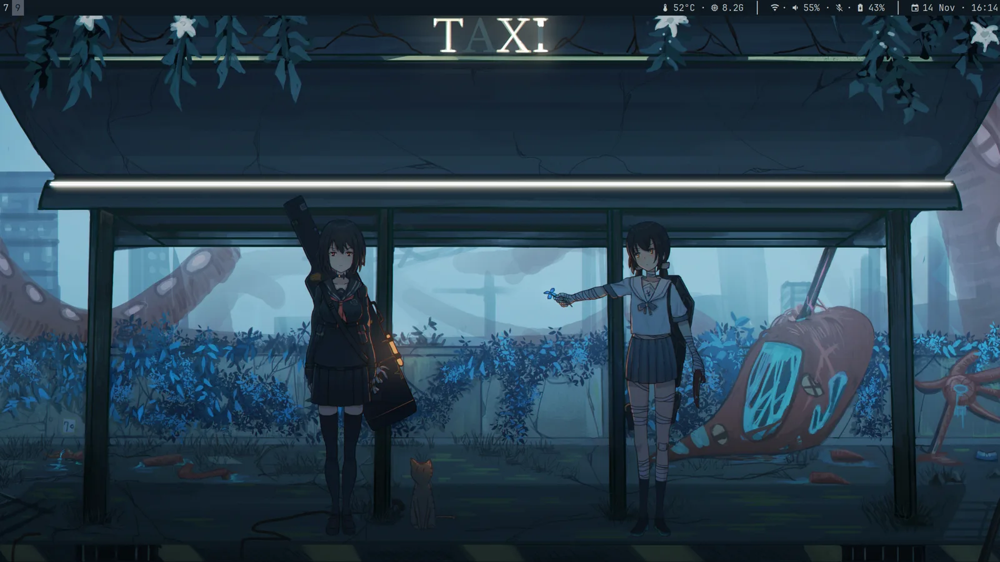
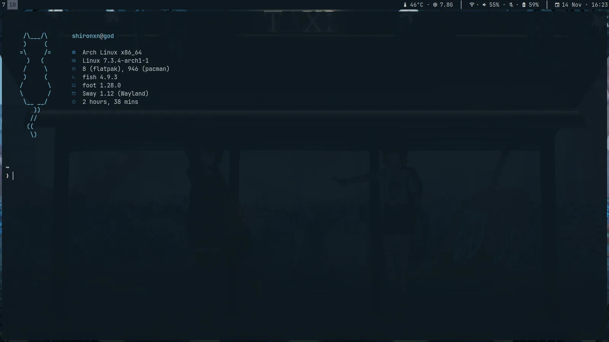
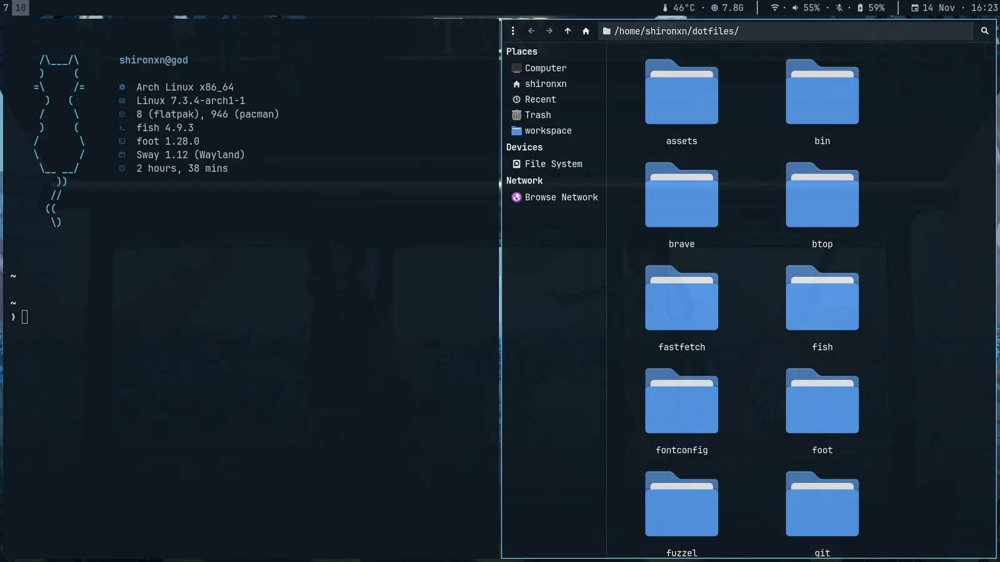

# dotfiles

Sway desktop on Arch Linux. Wallpapers drive the palette via pywal16.







## Requirements

```bash
sudo pacman -S sway swaybg swaylock swayosd foot fuzzel fish starship tmux \
  thunar mako wl-clipboard cliphist grim slurp wf-recorder brightnessctl \
  playerctl pipewire wireplumber networkmanager jq imagemagick ddcutil \
  papirus-icon-theme ttf-jetbrains-mono-nerd polkit-gnome mpv \
  ffmpegthumbnailer xdg-desktop-portal-wlr stow eza bat fastfetch \
  adw-gtk-theme pacman-contrib btop neovim
yay -S python-pywal16
```

Also install `noto-fonts-cjk` for the Japanese glyph fallback in fontconfig, and
a `Doro` cursor theme in `~/.local/share/icons/Doro` (or point `appearance.conf`,
the GTK settings, and `install.sh` at your own).

## Install

```bash
git clone https://github.com/shironxn/dotfiles.git ~/dotfiles
cd ~/dotfiles
./install.sh
```

Generate the initial palette:

```bash
~/.config/sway/scripts/wallpaper.sh ~/pictures/wallpapers/<wallpaper.jpg>
```

You can also right-click any image in Thunar and choose **Set as Wallpaper**.

## Keybindings

Press `Super+/` for the searchable cheatsheet generated from `keybinds.conf`.

| Key | Action |
|---|---|
| `Super+Return` | Terminal (`foot`) |
| `Super+d` | Application launcher |
| `Super+Tab` | Window switcher across workspaces |
| `Super+/` | Keybinding cheatsheet |
| `Super+Shift+s`, `Print` | Screenshot (area, window, or display) |
| `Super+Shift+r` | Screen recorder with desktop audio |
| `Super+Shift+w` | Wallpapers folder in Thunar |
| `Super+Shift+v` | Clipboard history |
| `Super+Shift+BackSpace` | Lock screen |
| `Super+Shift+Delete` | Power menu |

Hardware keys: volume, microphone mute, panel backlight, keyboard backlight
(via SwayOSD), external display brightness (via `ddcutil`), and media control
(via `playerctl`). Closing the laptop lid locks the screen and suspends.

## Scope

What belongs here: text config that decides how the desktop looks and behaves,
and would be identical on a freshly installed machine.

| In | Out |
|---|---|
| Sway, bar, and their scripts | machine-local overrides (see [Overrides](#overrides)) |
| Terminal, shell, prompt, tmux, pickers | `secrets.fish`, `fish_variables` (credentials and state) |
| Theme templates under `wal/` | `~/.cache/wal` (generated by pywal, rebuildable) |
| GTK, fontconfig, portal, pipewire, MIME, XDG dirs | `nvim` and other editor configs (own repo) |
| Portable app configs: btop, fastfetch, mpv, Brave flags | GUI app state: browser profiles, Obsidian, Spotify, Krita, `gh`, `go`, `yay` |
| Ship-with-the-config systemd user units | Package snapshots (they leak hardware and app choices) |
| `install.sh`, README, LICENSE | Screenshots, recordings, wallpapers (binaries) |

The test: if it would be the same on someone else's machine, track it. If it is
tied to this machine, this account's credentials, or regenerated by a tool,
leave it out.

`btop.conf` is the exception: btop rewrites the file in full on launch, so its
stock bulk is not cruft worth trimming.

## Overrides

Git-ignored files that load last for machine-specific settings. `install.sh`
creates none of them, so make the ones you actually need:

- `~/.config/sway/host.conf` (monitors, workspaces, input devices; see
  `sway/.config/sway/host.conf.example`)
- `~/.config/fish/config.local.fish`
- `~/.gitconfig.local` (included by `git/.config/git/config`; git ignores the
  include silently while the file is absent)

Credentials go in `~/.config/fish/conf.d/secrets.fish`, which is git-ignored.
Nothing tracked here is secret, so the repo stays public.

## License

MIT. See [LICENSE](LICENSE).
